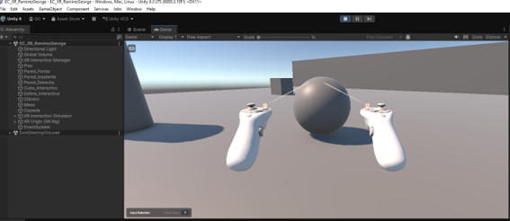
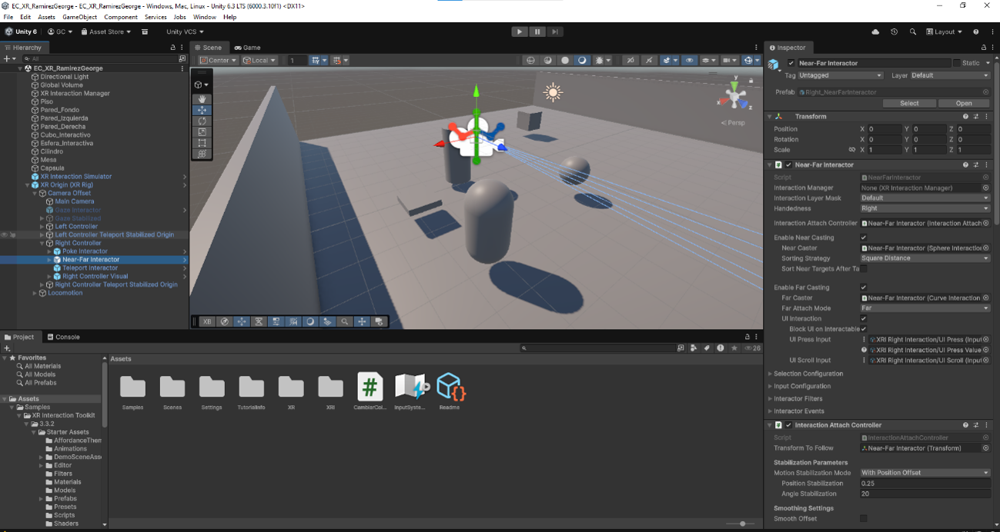
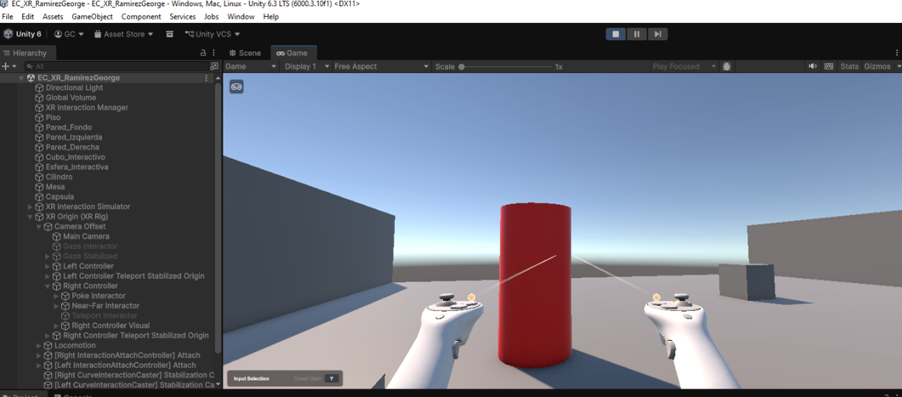

# Experiencia XR Interactiva en Unity

Alumno: George Ramirez  
Motor: Unity 6  
Tecnología: XR Interaction Toolkit  
Lenguaje:C#

## Descripción

Este proyecto consiste en el desarrollo de una experiencia XR básica utilizando Unity y XR Interaction Toolkit.

La escena permite simular el uso de controladores XR desde una computadora mediante XR Interaction Simulator. El usuario puede desplazarse por el entorno, apuntar hacia diferentes objetos e interactuar con ellos.

Se implementaron objetos con componentes físicos e interactivos, permitiendo realizar acciones como seleccionar, agarrar y mover objetos dentro de la escena.

Además, se desarrolló una interacción personalizada mediante C#, en la cual uno de los objetos cambia de color cuando el usuario realiza la interacción correspondiente.

## Características implementadas

- Entorno 3D desarrollado en Unity.
- Configuración de XR Origin (XR Rig).
- Uso de XR Interaction Toolkit.
- Uso de XR Interaction Simulator.
- Simulación de controladores izquierdo y derecho.
- Interacción mediante rayos XR.
- Objetos con Collider y Rigidbody.
- Selección e interacción con objetos.
- Manipulación y movimiento de objetos.
- Interacción personalizada mediante C#.
- Cambio de color de un objeto al interactuar.

## Controles

La experiencia puede probarse desde el editor de Unity utilizando XR Interaction Simulator.

Entre los controles utilizados se encuentran:

- `W`, `A`, `S`, `D`: movimiento.
- Ratón: orientación de la vista.
- `G`: acción Grip del controlador seleccionado.
- `T`: acción Trigger del controlador derecho.
- `Y`: mostrar u ocultar el panel Input Selection.
- `Space`: restablecer la posición del simulador.

> Los controles disponibles también pueden visualizarse directamente desde el panel de XR Interaction Simulator durante la ejecución.

## Interacción personalizada

Se creó el script `CambiarColorXR.cs` para demostrar una interacción personalizada dentro de la experiencia XR.

El script contiene una función pública que permite modificar el color del objeto. Esta función se encuentra vinculada a un evento del componente interactivo XR desde el Inspector de Unity.

De esta manera, cuando el usuario realiza la interacción configurada sobre el objeto, se ejecuta el método y el material cambia de color.

## Carpeta Evidencias

### Captura 1: Vista general de la experiencia XR

En la siguiente captura se observa la escena ejecutándose en Unity, incluyendo el entorno, los objetos interactivos y los controladores XR simulados.

### Captura 2: Configuración del sistema XR

Se muestra la configuración de la escena y los elementos relacionados con XR Origin, controladores e interactores utilizados para implementar la experiencia.

### Captura 3: Interacción con objetos

En esta evidencia se muestra la interacción realizada con uno de los objetos de la escena. Los objetos configurados pueden ser seleccionados y manipulados utilizando los controladores XR simulados.

También se implementó una interacción personalizada que permite modificar el color de un objeto mediante un evento XR.

## Estructura principal

Los elementos principales utilizados en la escena son:

- XR Interaction Manager
- XR Interaction Simulator
- XR Origin (XR Rig)
- Main Camera
- Left Controller
- Right Controller
- Objetos interactivos
- Colliders
- Rigidbody
- Componentes XR Interactable
- Script CambiarColorXR

## Requisitos

Para abrir y ejecutar el proyecto se requiere:

- Unity 6
- XR Interaction Toolkit
- Input System
- XR Interaction Simulator

## Ejecución

1. Abrir el proyecto desde Unity Hub.
2. Esperar a que Unity cargue los paquetes y dependencias.
3. Abrir la escena principal del proyecto.
4. Presionar el botón Play.
5. Utilizar XR Interaction Simulator para controlar la cámara y los controladores.
6. Acercarse o apuntar hacia los objetos interactivos.
7. Utilizar las acciones correspondientes para seleccionar e interactuar con ellos.

## Resultado

El proyecto demuestra la configuración básica de una experiencia XR en Unity, incorporando navegación, controladores simulados, interacción con objetos físicos y una interacción personalizada desarrollada mediante C#.

La experiencia puede ejecutarse y probarse directamente desde el editor de Unity sin necesidad de utilizar un visor XR físico.